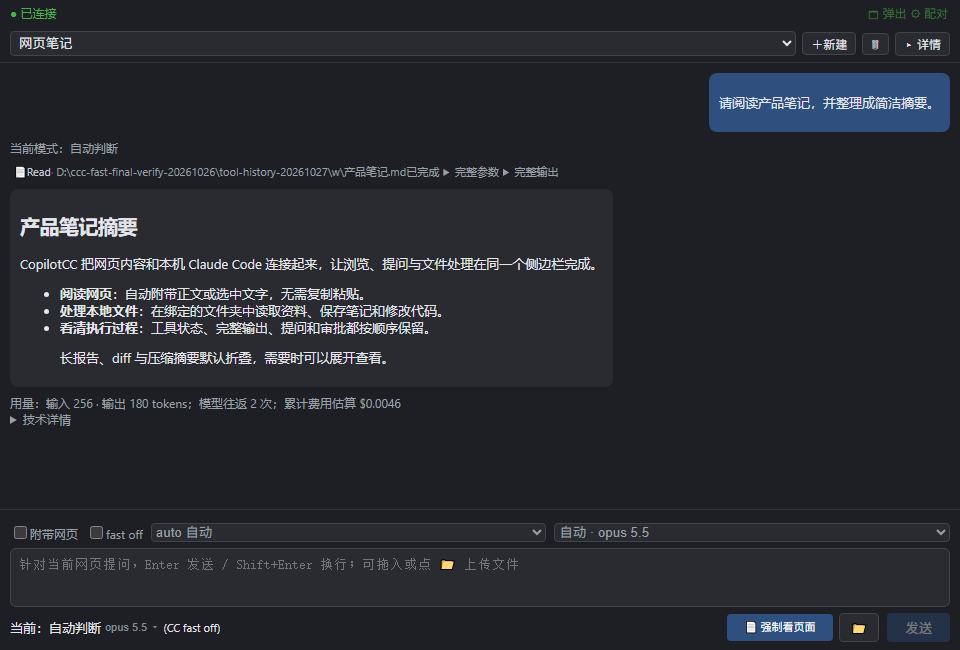
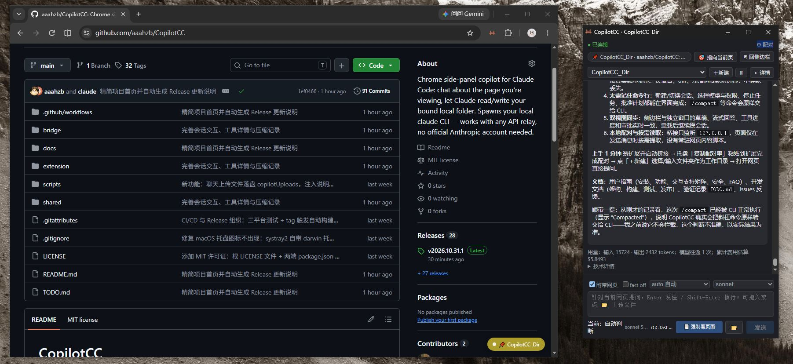

# CopilotCC

**把 Claude Code 放进 Chrome 侧边栏：一边看网页，一边让 Claude 阅读、提问并处理本地文件。**

[](https://github.com/aaahzb/CopilotCC/actions/workflows/ci.yml)
[](https://github.com/aaahzb/CopilotCC/releases/latest)
[](LICENSE)




CopilotCC 是免费开源的 Chrome MV3 扩展和本地桥接工具。它使用你已配置好的本机 Claude Code CLI，兼容现有 API 中转环境，不额外要求 Anthropic 官方登录。回复、工具执行、提问和审批直接显示在浏览器中。

## 下载

从 [Releases](https://github.com/aaahzb/CopilotCC/releases/latest) 下载对应资产：

| 平台 | 资产 | 运行方式 |
|---|---|---|
| Chrome / Edge | `ccc-extension-*-chrome.zip` | 解压到固定位置，在 `chrome://extensions` 开启开发者模式并选择「加载已解压的扩展程序」 |
| Windows 10+ x64 | `CopilotCC.exe` | 直接运行，无需安装、解压或管理员权限，常驻系统托盘 |
| macOS Apple Silicon | `ccc-bridge-darwin-arm64.dmg` | 首次右键打开 DMG 中的「首次使用-右键打开我.command」，详见[用户指南](docs/guide.md) |

使用前需要已安装并能正常运行 Claude Code CLI。macOS Intel 和 Linux 可从源码运行，暂无预编译包。

## 上手

1. 安装扩展，并启动对应平台的本地桥接。
2. 在托盘或菜单栏选择「复制配对串」，粘贴到扩展中完成配对。
3. 点「＋新建」，选择或输入一个文件夹作为工作目录，然后打开网页直接提问。

## 功能

- **网页上下文**：按需附带页面正文或选中文字，支持正文提取、长度设置和强制重新读取。
- **本地工作区**：绑定文件夹、管理多个会话、上传文件，并让 Claude 读取或修改你有权访问的本地文件。
- **完整时间线**：正文、工具调用、完整输出、diff、提问和审批按真实顺序显示，长内容默认折叠而不丢弃。
- **双视图同步**：侧边栏与独立窗口共享会话、草稿、流式输出和审批状态，独立窗口可继续指向原网页。
- **两种终端续聊**：在当前文件夹打开系统终端，或独立 Chrome 窗口中的 xterm.js + 真实 PTY 终端。终端接管期间聊天视图只读同步，退出后恢复输入。
- **界面完成常用操作**：切换模型与权限、停止任务、批准计划、回答提问；`/compact` 等斜杠命令原样交给 CLI。



## 安全边界

- WebSocket 只监听 `127.0.0.1`，使用随机 token 配对、Host 校验和扩展 Origin 白名单。
- 网页只在发送消息时按需读取，没有常驻网页内容脚本。
- 本地文件操作由本机 Claude Code CLI 执行，请只绑定你信任并有权修改的目录。
- 页面与上传文件名按不可信数据处理，新会话首条消息包含防提示注入说明。

## 文档

- [用户指南](docs/guide.md)：安装、功能、交互支持矩阵、安全说明和故障排查。
- [开发文档](docs/development.md)：架构、源码运行、验证、构建和发布。
- [当前待办与验证边界](TODO.md)：尚未覆盖的真实场景和人工复核项。
- [历史文档与证据](docs/history/README.md)：开发日志、macOS 交接和早期设计记录。
- [问题反馈](https://github.com/aaahzb/CopilotCC/issues)。

## 开发

需要 Node.js 22+。原生 PTY 构建与发布另需 Bun，完整前置条件见[开发文档](docs/development.md)。

```bash
npm --prefix bridge ci
npm --prefix extension ci

npm run dev:bridge       # 终端一：本地桥接
npm run dev:extension    # 终端二：扩展开发构建
npm run verify           # 提交前：检查、测试、类型检查和生产构建
```

共享协议只修改 `shared/` 下的源文件，再运行 `npm run sync:protocol`；不要直接编辑两端的生成副本。

## 许可证

[MIT](LICENSE) © aaahzb
