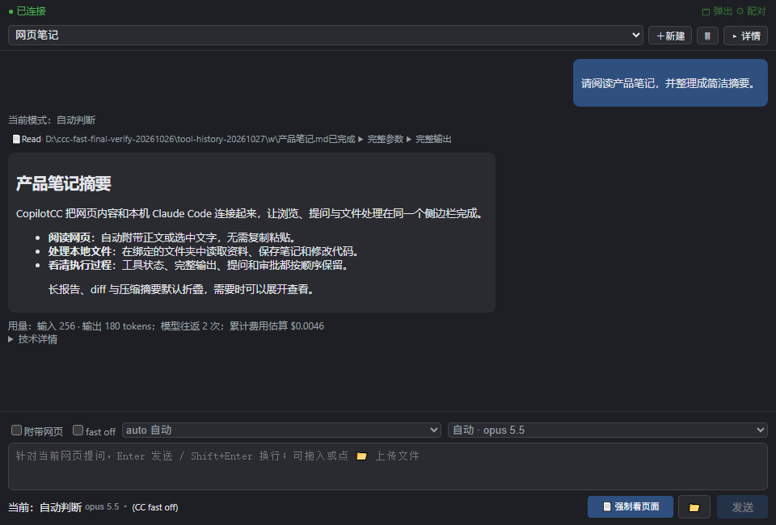

# CopilotCC

**把 Claude Code 放进 Chrome 侧边栏：一边看网页，一边让 Claude 阅读、提问并处理本地文件。**

CopilotCC 是免费开源的 Chrome 扩展 + 本地桥接工具。它使用你已经配置好的本机 Claude Code CLI，不额外要求 Anthropic 官方登录；网页不必复制粘贴，Claude 的回复、工具执行和审批过程都直接显示在浏览器里。

## 下载

| 平台 | 下载 | 运行要求 |
|---|---|---|
| **Chrome / Edge** | [扩展安装包](https://github.com/aaahzb/CopilotCC/releases/latest) | 解压后通过「加载已解压的扩展程序」安装 |
| **Windows 10+ x64** | [本地桥接](https://github.com/aaahzb/CopilotCC/releases/latest) | 解压后运行 `ccc-bridge.exe`，常驻系统托盘 |
| **macOS Apple Silicon** | [本地桥接 DMG](https://github.com/aaahzb/CopilotCC/releases/latest) | 仅 arm64；首次打开方式见[用户指南](docs/guide.md) |

使用前需要已安装并能正常运行的 Claude Code CLI。macOS Intel 和 Linux 可从源码运行。

## 核心亮点

- **网页就是上下文**：自动附带页面正文或选中文字，支持文章提取、丰富度设置和强制重新读取。
- **不只是聊天**：上传文件、读取网页，并让 Claude 在你绑定的文件夹中写笔记、改代码。
- **过程完整可见**：正文、工具状态、输出、错误、提问和审批按真实顺序显示；长报告、diff 和压缩摘要默认折叠，不静默丢失。
- **无需记住命令行**：新建/切换会话、选择模型与权限、停止任务、批准计划都可在界面完成；`/compact` 等命令也会原样交给 CLI。
- **侧边栏与独立窗口同步**：草稿、流式回答、工具进度和审批在双视图中实时一致，重载后继续原会话。
- **本地配对与按需读取**：桥接只监听 `127.0.0.1`，页面仅在发送消息时按需提取，没有常驻网页内容脚本。

## 上手 1 分钟

1. 安装扩展并启动对应平台的本地桥接。
2. 在托盘/菜单栏中选择「复制配对串」，粘贴到扩展完成配对。
3. 点「＋新建」，选择或输入一个文件夹作为工作目录，然后打开网页直接提问。

完整安装、macOS 首次打开、网页附带规则和故障排查请查看用户指南。

## 文档

- [用户指南](docs/guide.md)：安装、全部功能、交互支持矩阵、安全说明和 FAQ。
- [开发文档](docs/development.md)：架构、构建、测试、发布流程和项目结构。
- [验证记录](TODO.md)：真实 CLI / Chrome 验收范围与尚未覆盖的边界。
- [问题反馈](https://github.com/aaahzb/CopilotCC/issues)：报告问题或提出需求。

## 开发

Chrome MV3 + React 19 + WXT，本地桥接使用 Node.js 22、Agent SDK 与本机 Claude CLI。构建和完整验证命令见[开发文档](docs/development.md)。

## 许可证

[MIT](LICENSE) © aaahzb
